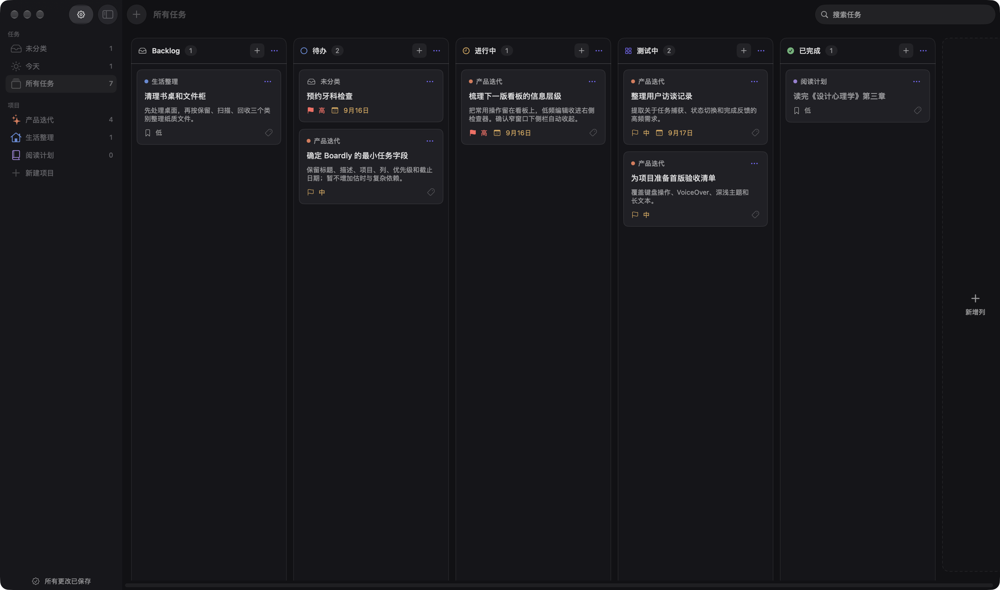

# Boardly

Boardly 是一款 macOS 个人任务看板，支持按项目组织任务、自定义工作流，并将数据保存在本机。

[](Package.swift)
[](Package.swift)
[](LICENSE)

## 功能

- **项目与工作流**：创建项目，自定义项目图标和颜色；新增、编辑、排序和删除看板列。
- **任务管理**：设置标题、说明、优先级、项目和截止日期，通过拖放或菜单移动任务。
- **筛选与搜索**：查看所有任务、今天、未分类或指定项目的任务，使用工具栏搜索任务。
- **草稿编辑**：在右侧悬浮详情面板编辑任务，确认保存后生效；关闭未保存的修改时提示确认。
- **显示设置**：调整字号、卡片密度，以及任务说明和元数据的显示方式。
- **本地保存与备份**：自动保存已确认的修改，创建每日快照，并在删除任务、项目或列前创建安全快照。

## 界面预览

主看板展示项目分类、自定义状态列和任务卡片，截图使用示例数据。



## 安装与快速开始

### 环境要求

| 项目 | 要求 |
| --- | --- |
| 操作系统 | macOS 14 Sonoma 或更高版本 |
| 构建工具 | Swift 6 工具链、Xcode Command Line Tools |
| 依赖 | 无第三方 Swift Package 依赖 |

应用使用 SwiftUI，当前界面采用深色主题。使用时无需账号或网络服务。

### 从源码运行

1. 克隆仓库并进入项目目录：

   ```bash
   git clone https://github.com/Zorabi/Boardly.git
   cd Boardly
   ```

2. 构建并运行：

   ```bash
   swift run Boardly
   ```

### 安装到“应用程序”

1. 在项目根目录生成应用：

   ```bash
   bash Sources/Boardly/Resources/make-app.sh
   ```

   构建结果位于 `build/Boardly.app`，可直接打开体验。

2. 退出正在运行的 Boardly，再安装并启动：

   ```bash
   ditto build/Boardly.app /Applications/Boardly.app
   open /Applications/Boardly.app
   ```

## 使用说明

1. 从侧边栏选择任务范围，或通过“新建项目”添加项目。
2. 使用工具栏的加号新建任务；列标题上的加号可直接在该列创建任务。
3. 拖动任务卡片调整顺序或移动到其他列，通过列菜单管理工作流。
4. 单击卡片打开右侧悬浮详情面板，编辑后选择“保存”；若放弃修改，使用“取消”并按提示确认。
5. 使用工具栏齿轮按钮或 `⌘,` 打开设置，调整显示方式与自动快照保留期。设置修改立即生效。

详情与设置面板覆盖在看板右侧，展开和收起时看板保持原位；启用系统“减少动态效果”后，面板直接显示或隐藏。

### 快捷键

| 操作 | 快捷键 |
| --- | --- |
| 新建任务 | `⌘N` |
| 打开或关闭看板设置 | `⌥⌘I` |
| 打开看板设置 | `⌘,` |
| 取消表单或关闭当前面板 | `Esc` |
| 保存任务详情或确认表单 | `Return` |

任务详情存在未保存修改时，取消或关闭会先提示确认。

启用 macOS 键盘导航后，可使用 `Tab`、`Shift+Tab` 切换控件焦点。按钮、菜单和选择器使用柔和的背景变化提示焦点，选项通过背景或勾选图标显示选中状态；文本输入保留光标与必要的输入边界。

### 数据与备份

项目、列和任务在修改确认后自动保存，写入失败时会显示提示。首次运行且没有已有数据时，应用会载入示例任务。

| 数据 | 保存位置 |
| --- | --- |
| 项目、列和任务 | `~/.Boardly/board.json` |
| 显示与备份偏好 | macOS 偏好设置 |
| 自动快照 | `~/.Boardly/backups/auto/` |
| 数据恢复备份 | `~/.Boardly/backups/recovery/` |

默认在普通保存时每天创建一份自动快照，删除前另外创建安全快照。可在设置中调整每日和每月快照保留期，或关闭普通保存的每日快照；删除前的安全快照仍会保留。

应用不提供账号、在线同步或遥测。手动备份时，请先退出应用，再复制整个 `~/.Boardly` 目录。

## 开发与测试

在项目根目录执行：

```bash
swift build
swift test
```

测试涉及任务移动与排序、自定义列、任务详情保存、本地持久化、备份策略和偏好设置。

| 路径 | 内容 |
| --- | --- |
| `Sources/Boardly/` | 应用源码与资源 |
| `Tests/BoardlyTests/` | 单元测试 |
| `docs/images/` | 界面截图 |
| [产品与交互设计](docs/PRODUCT_DESIGN.md) | 产品设计参考 |
| [macOS 视觉规范](design-system/todos-mac/MASTER.md) | 界面设计参考 |

## 贡献

通过 [Issue](https://github.com/Zorabi/Boardly/issues) 报告问题或提出建议。报告问题时请附上 macOS 版本、复现步骤、预期行为和实际结果。

提交 Pull Request 前请运行 `swift test`；界面修改请附上截图，并说明验证过的交互。

## 许可证

SPDX：`AGPL-3.0-only`。

Copyright (c) 2026 dongx。

本项目基于 [GNU Affero General Public License v3.0](LICENSE) 发布。
